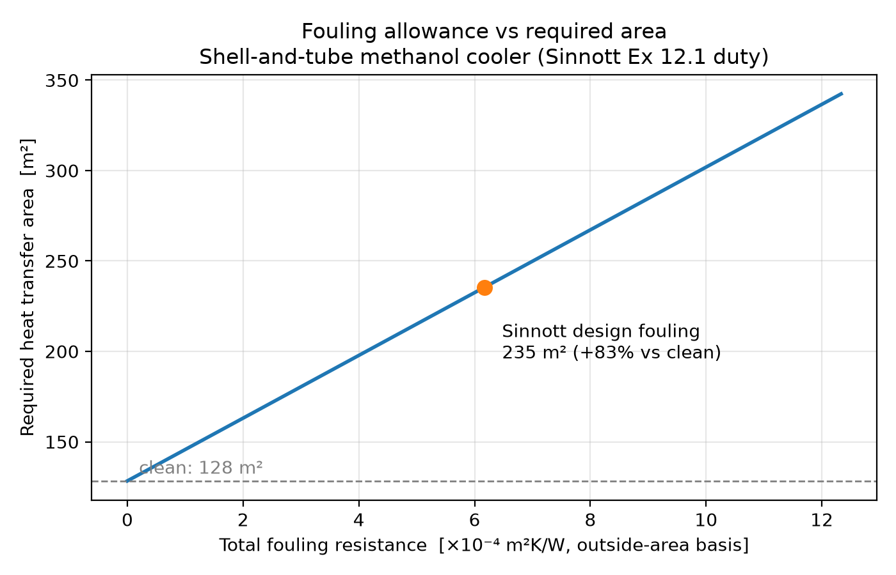
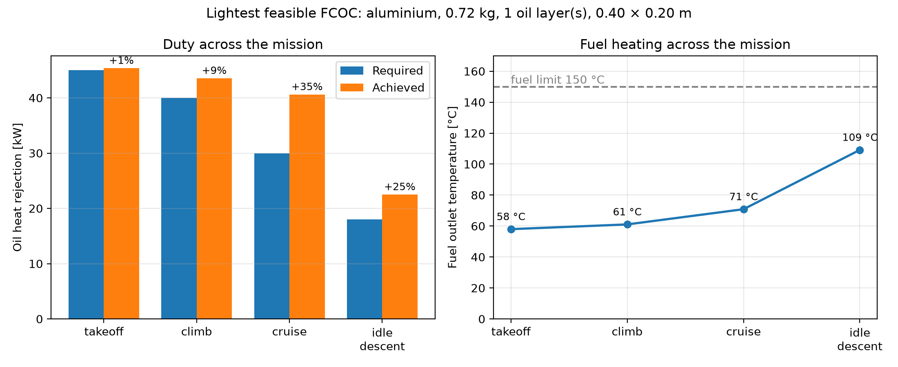
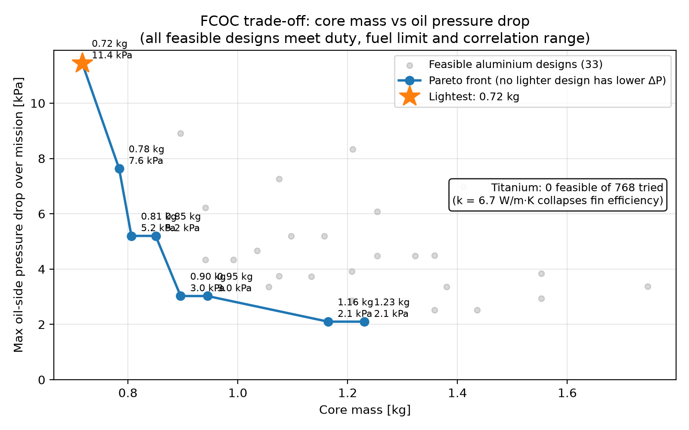

# hx-design

**Heat exchanger sizing and rating tool for industrial and aero-engine applications.**

A Python package for the thermal and hydraulic design of three exchanger types (double-pipe, shell-and-tube and compact plate-fin), validated against published textbook worked examples and applied to two case studies: a fouled industrial process cooler and a turbofan fuel-cooled oil cooler (FCOC) sized across a flight mission.

Analytical relations are used throughout in place of chart reading, and every validation case is covered by automated tests (`pytest`, 69 tests).

---

## Key results

| | Result |
|---|---|
| **Validation** | Primary outputs (length, overall U, area) match three textbook cases to within **1.3%** |
| **Textbook discrepancies found** | Three in Sinnott Ex 12.1 (chart-read F-factor, an arithmetic slip in the equivalent diameter, a rule-of-thumb redesign) and two chart readings in Incropera Ex 11.3–11.4 |
| **Fouling** | Standard fouling allowances increase the required area of a shell-and-tube cooler by **83%** |
| **Aero FCOC** | Lightest feasible design: **0.72 kg aluminium core** meeting all four mission points |
| **Materials** | Titanium: **0 feasible designs out of 768**. Low conductivity collapses fin efficiency |
| **Trade-off** | Reducing oil-side ΔP from 11.4 to 2.1 kPa costs **62% more core mass** |

---

## Features

**Methods** (`hx/methods.py`)
- Energy balance, LMTD (counterflow, parallel)
- ε-NTU: counterflow, parallel, 1-shell/2n-pass, crossflow (both fluids unmixed)
- Analytical LMTD correction factor F for 1-2 shells (no chart reading)
- Numerical inverse of the crossflow ε-NTU relation (`scipy.optimize.brentq`)
- Physical-limit checks: unreachable effectiveness raises an error instead of returning a meaningless area

**Correlations** (`hx/correlations.py`)
- Dittus–Boelter, Gnielinski, laminar tube (Nu = 3.66) and laminar annulus (Incropera Table 8.2)
- Petukhov (smooth) and Haaland (rough) friction factors

**Fluid properties** (`hx/properties.py`)
- Water: CoolProp (IAPWS)
- Engine oil: Incropera Table A.5
- Turbine oil (Mobil Jet Oil II, MIL-PRF-23699): ASTM D341 (Walther) viscosity fit to datasheet values; conductivity from NIST IR 8263
- Jet A-1: n-dodecane surrogate (CoolProp)

**Exchanger models**
- `double_pipe.py`: sizing and rating, with property iteration at mean temperatures
- `shell_tube.py`: Kern method; bundle and shell geometry, film coefficients, wall and fouling resistances, tube- and shell-side pressure drop
- `plate_fin.py`: offset strip fins (Manglik–Bergles j and f), fin and surface efficiency, crossflow rating, core mass, volume and pressure drop
- `fcoc.py`: FCOC case study: mission evaluation, feasibility checks, Pareto front

---

## Validation

### Case 1: Double-pipe lube-oil cooler (Incropera 7th ed., Ex 11.1)

| Quantity | Incropera | This tool | Error |
|---|---|---|---|
| Heat duty q | 8524 W | 8524 W | 0.0% |
| Water outlet T | 40.2 °C | 40.2 °C | 0.0% |
| ΔT_lm | 43.2 °C | 43.2 °C | 0.0% |
| h_i (water) | 2250 W/m²K | 2249 W/m²K | −0.05% |
| h_o (oil, laminar annulus) | 38.8 W/m²K | 38.93 W/m²K | +0.3% |
| Overall U | 38.1 W/m²K | 38.27 W/m²K | +0.4% |
| **Required length L** | **65.9 m** | **65.65 m** | **−0.4%** |

- The remaining gap comes from the book rounding the annulus Nusselt number to 5.63 (interpolated value: 5.64).
- The oil side is ~98% of the total thermal resistance, so switching the water-side correlation (Dittus–Boelter → Gnielinski) changes L by less than 1%.
- **With temperature-dependent properties** (iterated at stream mean temperatures), the rated oil outlet is 59.91 °C vs the book's 60 °C, converging in 4 iterations. Evaluating properties at the inlet instead of the mean gives a 1.2 °C error, because oil viscosity halves between 80 and 100 °C.

### Case 2: Shell-and-tube methanol cooler, Kern method (Sinnott, *Coulson & Richardson Vol. 6*, 4th ed., Ex 12.1)

| Quantity | Sinnott | This tool | Note |
|---|---|---|---|
| Bundle diameter | 826 mm | 826 mm | same correlation |
| Shell cross-flow area | 0.032 m² | 0.0318 m² | book rounding |
| Equivalent diameter d_e | 14.4 mm | **14.2 mm** | **book arithmetic slip**: 1.10/20 × (25² − 0.917×20²) = 14.20 |
| Shell Re | 36,762 | 36,454 | follows from d_e |
| h_shell | 2740 W/m²K | 2673 W/m²K | −2.4%: Kern correlation vs chart reading |
| h_tube | 3812 W/m²K | 3893 W/m²K | +2.1%: Gnielinski vs chart reading |
| **Overall U** | **738 W/m²K** | **737 W/m²K** | **−0.2%** |
| F-factor | 0.85 (chart) | **0.812** (analytical) | chart read in a steep region; the book's design is ~5% undersized at this step |
| Tube ΔP | 7.2 kPa | 6.9 kPa | −5% with commercial-steel roughness (ε = 45 µm); smooth tube gives 6.2 kPa |
| Shell ΔP | 272 kPa | 286 kPa | +5%; j_f digitised from Sinnott Fig. 12.30 |

**Baffle-spacing redesign.** Sinnott doubles the baffle spacing to cut the excessive shell-side ΔP and estimates the effect with rules of thumb. A full recalculation shows the shortcut is conservative:

| After doubling baffle spacing | Sinnott estimate | Full recalculation |
|---|---|---|
| Shell ΔP | 68 kPa | **39 kPa** |
| h_shell | 1573 W/m²K | **1826 W/m²K** |
| U | 615 W/m²K | **654 W/m²K** |

The book scales ΔP by (½)² for the halved velocity, but the number of cross-flow passes (L/l_B) also halves, so the true reduction is closer to ⅛. It also scales h with Re^0.8, whereas Kern's correlation uses Re^0.55.

### Case 3: Finned-tube cross-flow exchanger (Incropera 7th ed., Ex 11.3 and 11.4)

| Quantity | Incropera (chart) | This tool (Eq. 11.32) | Difference |
|---|---|---|---|
| NTU for ε = 0.755 (Ex 11.3) | ≈ 2.0 | 2.03 | |
| **Required area (Ex 11.3)** | **37.8 m²** | **38.3 m²** | **+1.3%** |
| Effectiveness (Ex 11.4) | 0.82 | 0.845 | +3%: chart reading |

---

## Case study 1: Effect of fouling on a shell-and-tube cooler

Using the Sinnott Ex 12.1 duty (4.34 MW methanol cooler), Sinnott's design fouling resistances were scaled from zero (clean) to twice their value.



- Clean exchanger: **128 m²**. With Sinnott's design fouling: **235 m² (+83%)**.
- The relationship is exactly linear, because fouling adds directly to the series thermal resistance:
  A = (q / ΔT_m) · (1/U_clean + R_f), so each 10⁻⁴ m²K/W of fouling adds about 17 m² here.
- Sinnott's provisional area (278 m²) is higher because it assumes U = 600 W/m²K and F = 0.85, rather than the calculated U and analytical F.

---

## Case study 2: Turbofan fuel-cooled oil cooler (FCOC)

Aero-engine lubricating oil is cooled by the engine fuel on its way to the combustor, in a compact aluminium plate-fin exchanger. The design goal is the **lightest core** that rejects the required oil heat load at **every** mission point, while keeping:
- the fuel below its thermal-stability limit (**150 °C**, conservative against the ASTM coker test at 149 °C and NASA's cited 177 °C limit), and
- both streams inside the validated range of the Manglik–Bergles correlations (**120 ≤ Re ≤ 10,000**). Designs outside it are rejected, not extrapolated.

**Mission (illustrative, CFM56-class engine).** Manufacturer FCOC loads are not published, so these are stated assumptions; fuel flows are in the range of ICAO emissions databank values. Oil: 0.5 kg/s entering at 130 °C.

| Point | Fuel flow | Fuel inlet | Required oil heat rejection |
|---|---|---|---|
| Take-off | 1.10 kg/s | 40 °C | 45 kW |
| Climb | 0.90 kg/s | 40 °C | 40 kW |
| Cruise | 0.35 kg/s | 20 °C | 30 kW |
| Idle descent | 0.12 kg/s | 30 °C | 18 kW |

**Design sweep.** 768 cores per material: 2 oil fin geometries × 2 fuel fin geometries × 1–3 oil layers × 8 × 8 core dimensions (0.10–0.45 m), in aluminium (k = 170 W/m·K) and titanium (k = 6.7 W/m·K).

### Lightest feasible design

0.72 kg aluminium core, 1 oil layer and 2 fuel layers, 0.40 × 0.20 m. Oil fins s = 1.5, h = 6.0, t = 0.15, l = 3.0 mm; fuel fins s = 1.0, h = 2.5, t = 0.10, l = 3.0 mm.



| Point | Required | Achieved | Margin | Fuel outlet | Fuel Re |
|---|---|---|---|---|---|
| Take-off | 45 kW | 45.4 kW | +1% | 58 °C | 901 |
| Climb | 40 kW | 43.5 kW | +9% | 61 °C | 754 |
| Cruise | 30 kW | 40.6 kW | +35% | 71 °C | 272 |
| Idle descent | 18 kW | 22.5 kW | +25% | **109 °C** | **129** |

**Findings**
1. **Take-off sets the size** (smallest margin), but **idle descent is the critical check**: the fuel is hottest there (109 °C, 41 K below the limit) and its Reynolds number is barely inside the correlation's validated range.
2. **The correlation's validity range, not the physics, bounds the design space.** Only 33 of 768 aluminium designs were feasible. Viscous oil in small fin passages runs at low Re, so more layers or larger cores push the oil side below Re = 120.
3. **Titanium is ruled out:** 0 feasible designs. For the same geometry as the lightest aluminium design, a titanium core is 64% heavier (1.18 kg) and rejects 42% less heat at take-off (26 kW), because its low conductivity collapses fin efficiency.

### Mass vs pressure-drop trade-off



- Fuel-side ΔP shows **no trade-off**: the lightest design also has the lowest fuel ΔP (7.3 kPa).
- The binding trade-off is on the **oil side**, which the scavenge pump must overcome: cutting oil ΔP from 11.4 kPa to 2.1 kPa takes the core from 0.72 kg to 1.16 kg (**+62%**).

---

## Usage

```python
from hx.double_pipe import Stream, size_double_pipe, rate_double_pipe_auto

# Incropera Ex 11.1: oil in the annulus, water in the tube
oil = Stream(m_dot=0.1, cp=2131, mu=3.25e-2, k=0.138, T_in=100)
water = Stream(m_dot=0.2, cp=4178, mu=725e-6, k=0.625, T_in=30)

r = size_double_pipe(oil, water, Th_out=60, Di=0.025, Do=0.045,
                     hot_in="annulus", method="dittus_boelter")
print(f"Required length: {r['L']:.2f} m, U = {r['U']:.1f} W/m2K")

# Rating with temperature-dependent properties
r = rate_double_pipe_auto("engine_oil", "water", m_hot=0.1, m_cold=0.2,
                          Th_in=100, Tc_in=30, L=65.9, Di=0.025, Do=0.045,
                          hot_in="annulus", method="dittus_boelter")
print(f"Oil outlet: {r['Th_out']:.2f} C after {r['iterations']} iterations")
```

## Running

```bash
python -m venv .venv
source .venv/bin/activate          # Windows: .venv\Scripts\activate
pip install -r requirements.txt

python -m pytest                   # 69 tests, including all validation cases
python -m examples.plot_fouling    # Case study 1 figure
python -m examples.fcoc_study      # Case study 2: sweep + mission and Pareto figures
```

## Repository structure

```
hx/
├── methods.py        LMTD, F-factor, ε-NTU relations
├── correlations.py   Nusselt and friction correlations
├── properties.py     water, engine oil, turbine oil, jet fuel
├── double_pipe.py    double-pipe sizing and rating
├── shell_tube.py     Kern-method shell-and-tube model
├── plate_fin.py      offset strip fin plate-fin model
└── fcoc.py           FCOC case study: mission, feasibility, Pareto
tests/                one test file per module; validation cases included
examples/             scripts that reproduce every figure
figures/              generated plots
```

---

## Limitations and assumptions

**Methods**
- The transition region (2300 < Re < 3000) uses Gnielinski without a transition correction.
- Shell side uses the Kern method, which ignores leakage and bypass streams; suitable for preliminary design, not detailed rating (Bell–Delaware not implemented).
- The shell-side friction factor is a power-law fit digitised from Sinnott Fig. 12.30 for a 25% baffle cut only, valid for 10⁴ < Re < 10⁶.
- Double-pipe inner tube treated as thin-walled; plate-fin parting-plate resistance neglected (thin, highly conductive plates).
- Plate-fin pressure drop is core friction only (no entrance, exit or header losses); core mass excludes side bars and headers.
- Manglik–Bergles correlations are accurate to about ±20% and are applied only within 120 ≤ Re ≤ 10,000.
- Single-phase flow only; no mechanical, vibration or cost design.

**Data**
- Jet A-1 is represented by n-dodecane (CoolProp), a standard surrogate; its density is ~6% lower than Jet A-1, and it is valid only above ~0 °C.
- Turbine-oil specific heat taken from Incropera's engine oil table (mineral oil) as an approximation; oil thermal expansion coefficient (7×10⁻⁴ K⁻¹) assumed.
- FCOC mission loads and flows are illustrative assumptions, not manufacturer data.

---

## References

1. Bergman, Lavine, Incropera & DeWitt, *Fundamentals of Heat and Mass Transfer*, 7th ed., Wiley, 2011.
2. Sinnott, *Coulson & Richardson's Chemical Engineering, Vol. 6: Chemical Engineering Design*, 4th ed., Elsevier, 2005.
3. Manglik & Bergles, "Heat transfer and pressure drop correlations for the rectangular offset strip fin compact heat exchanger", *Experimental Thermal and Fluid Science* 10 (1995) 171–180.
4. NIST IR 8263, *Thermophysical Properties of Polyol Ester Lubricants*, 2019.
5. ExxonMobil, Mobil Jet Oil II product data sheet.
6. NASA CR-72951, *Heat Sink Capability of Jet A Fuel*, 1971.
7. Bell, Wronski, Quoilin & Lemort, "Pure and pseudo-pure fluid thermophysical property evaluation and the open-source thermophysical property library CoolProp", *Ind. Eng. Chem. Res.* 53 (2014) 2498–2508.

## Licence

MIT